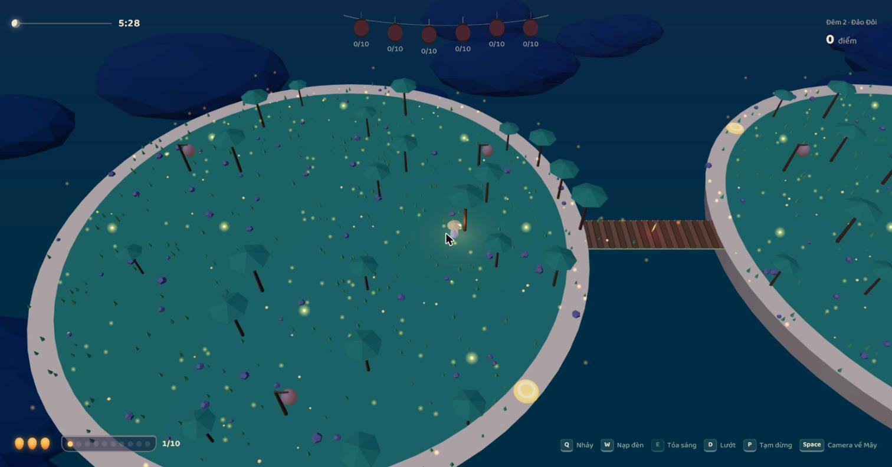
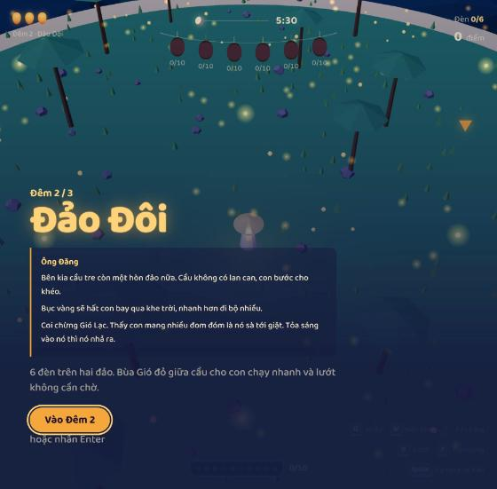
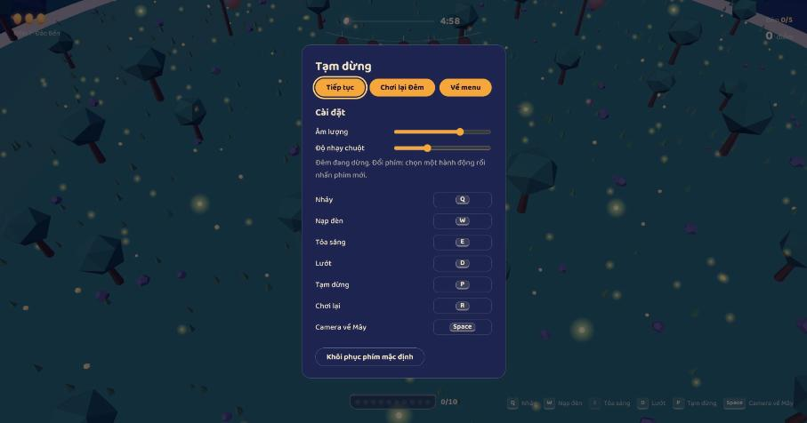

# Đảo Đèn Lồng

> Video demo: _(bổ sung ở Phase 4)_

Game 3D góc nhìn từ trên xuống. Sương đen đã nuốt ánh sáng của ba hòn đảo. Bạn là **Mây**, người giữ đèn nhỏ tuổi đội nón lá treo một chiếc đèn lồng nhỏ. Qua ba Đêm liền, Mây gom đom đóm về thắp lại Đèn Lồng Lớn của từng đảo trước khi trời sáng. Trên đường phải né **Bóng Mực** trôi ra từ sương và **Gió Lạc** chuyên giật đom đóm.



Bài làm lab *AI SDLC* (Day 12) của 2A202603689-VuHaiTuan. Tài liệu của lab nằm ở [LAB.md](LAB.md).

## Cài đặt và chạy

Cần Node.js 18 trở lên, chạy trên Linux hoặc macOS.

```bash
git clone https://github.com/ha1tuan/K5-L3A-DAY12-VuHaiTuan-2A202603689-AI-SDLC-Dao-Den-Long.git && cd K5-L3A-DAY12-VuHaiTuan-2A202603689-AI-SDLC-Dao-Den-Long
npm ci && npm run build
npm start
```

`npm start` mở game ở <http://localhost:4173>. Thêm `?night=2` hoặc `?night=3` vào địa chỉ để vào thẳng Đêm đó, tiện khi thử.

## Điều khiển

| Thao tác | Mặc định |
|---|---|
| Đi tới một điểm | Nhấn chuột trái lên mặt đất (bậc, cầu, đảo bên kia đều được) |
| Nhảy | Q |
| Nạp đom đóm vào đèn gần nhất | W |
| Tỏa sáng | E |
| Lướt | D |
| Tạm dừng (menu Tiếp tục / Chơi lại Đêm / Về menu và Cài đặt) | Esc hoặc P |
| Sang Đêm kế tiếp / chơi lại (ở màn kết quả) | R |
| Nhìn quanh đảo | Đưa chuột ra mép màn hình |
| Đưa camera về Mây / giữ để bám theo | Space |
| Phóng to, thu nhỏ | Lăn chuột |

Trong menu Tạm dừng có thể đổi phím, chỉnh âm lượng và độ nhạy chuột (tốc độ trượt camera và bước zoom). Mọi thứ được lưu trong trình duyệt. Esc luôn dùng để tạm dừng, không gán lại được.

## Ba Đêm

| Đêm | Đảo | Thời gian | Đèn | Điểm mới |
|---|---|---|---|---|
| 1 | Đảo Bến | 5:00 | 5 | Đảo tròn bán kính 40 m |
| 2 | Đảo Đôi | 5:30 | 6 | Hai đảo nối bằng cầu tre không lan can; hai bục nhảy hất qua khe trời; Gió Lạc; Bùa Gió giữa cầu |
| 3 | Đảo Tháp Chuông | 6:00 | 7 | Bậc cao 3 m và 6 m, hai dốc lên bậc, tháp chuông ở giữa; Bóng Mực nhanh hơn (4.5 m/s); gió mạnh |

Trước mỗi Đêm, **Ông Đăng** giới thiệu hòn đảo và mẹo của Đêm đó. Thắng thì điểm Đêm được cộng vào tổng và sang Đêm kế. Thua thì chơi lại chính Đêm đó, không cộng gì. Thắng Đêm 3 thì tới **Màn Bình Minh** với tổng điểm cả chuỗi.

## Luật chơi

- **Đom đóm** tự bay vào lọ khi Mây đi qua (trong 1 m), tối đa 10 con.
- **Nạp:** đứng trong 2 m quanh một đèn chưa sáng rồi nhấn W. Mỗi đèn cần 10 đom đóm, nạp nhiều lần cũng được. Đủ 10 thì đèn sáng.
- **Bóng Mực** xuất hiện từ giây thứ 5, lúc đầu lang thang, tới gần 12 m thì đuổi. Bị chạm thì mất 1 Ngọn Lửa và rơi một nửa số đom đóm đang mang (làm tròn xuống) ra đất; đom đóm rơi biến mất sau 8 giây. Sau đó Mây có 1.5 giây không bị chạm.
- **Tỏa sáng** tốn 3 đom đóm, làm choáng 2 giây mọi Bóng Mực trong vòng 5 m và đẩy chúng lùi 4 m. Sau mỗi lần tỏa sáng phải chờ 3 giây.
- **Lướt** đi 14 m/s trong 0.2 giây theo hướng đang chạy, giữ nguyên độ cao nếu đang ở trên không. Chờ 1.5 giây mới lướt tiếp. Lướt không giúp né đòn.
- **Chỗ trú:** Bóng Mực không vào được vòng 6 m quanh một đèn **đã sáng**. Con nào đang ở trong lúc đèn vừa thắp bị đẩy ra ngoài.
- **Gió Lạc** (Đêm 2 và 3): 20 giây xuất hiện một con, tối đa 2. Khi Mây mang từ 5 đom đóm trở lên và ở gần, nó sà tới giật tối đa 3 con rồi bỏ chạy. Tỏa sáng trúng nó thì nó nhả lại đom đóm. Nó giật được cả khi Mây đang trong chỗ trú.
- **Bùa Gió:** nhặt được thì trong 10 giây Mây chạy 7.2 m/s và lướt không phải chờ. Bùa mọc lại sau 45 giây.
- **Rơi khỏi đảo:** mép đảo không có rào. Rơi xuống biển mây thì mất 1 Ngọn Lửa và toàn bộ đom đóm đang mang, 1 giây sau Mây quay lại điểm xuất phát.
- **Gió mạnh** (Đêm 3): cứ 30 giây thổi 5 giây, đẩy Mây thêm 2 m/s theo một hướng. Lá bay và banner báo trước 2 giây.
- **Thắng** khi mọi đèn của Đêm sáng. **Thua** khi hết 3 Ngọn Lửa, hoặc khi hết giờ mà trời đã sáng. Hết Ngọn Lửa luôn là thua, kể cả khi cùng lúc thắp đèn cuối cùng.

## Cách tính điểm

| Sự kiện | Điểm |
|---|---|
| Mỗi đom đóm nạp vào đèn | +10 |
| Thắp sáng một đèn | +100 |
| Mỗi Bóng Mực trúng một lần tỏa sáng | +5 |
| Khi thắng: mỗi giây còn lại (làm tròn xuống) | +2 |
| Khi thắng: mỗi Ngọn Lửa còn lại | +50 |

Nhặt đom đóm không có điểm; điểm tính lúc nạp. Thưởng thời gian và Ngọn Lửa chỉ cộng khi thắng.

**Ví dụ:** nạp 1 đom đóm làm sáng đèn cuối cùng ở tick 1 với 3 Ngọn Lửa. Điểm là 10 + 100 + 2 × ⌊299.98⌋ + 50 × 3 = **858**. Đây đúng là case `win-all-lit` trong bộ kiểm chứng.

## Chế độ headless (Test Contract v1.1)

Mọi số tuning khai trong [`game.contract.json`](game.contract.json) cũng chính là số game đang dùng, vì sim đọc trực tiếp file này. Đây đúng bộ số chuẩn của PRD v2 §6.1.

```bash
node dist/headless.js --seed 1 --night 1|2|3 --ticks 600 --out out.jsonl \
  [--scenario scenarios/p2-charm.json] [--inputs inputs/p2-charm-run.json] [--snapshot-every 10]
```

- Logic chạy 60 tick/giây cố định, không cần cửa sổ hay GPU. Trọn một Đêm 3 (21 600 tick) chạy trong khoảng 1 s.
- Inputs có thêm `dash` và `pause`. Khi tạm dừng, `tick` vẫn tăng nhưng `sim_tick`, đồng hồ và mọi bộ đếm đứng yên; snapshot có `state: "paused"`.
- Snapshot v1.1 có thêm `night`, `wind`, thông tin của Mây (vận tốc, chạm đất, hồi chiêu, bùa), danh sách đom đóm, Gió Lạc và Bùa Gió.
- Exit code: `0` khi chạy xong hoặc game kết thúc, `2` khi file inputs/scenario sai định dạng, `1` khi gặp lỗi khác. Thông báo lỗi ghi ra stderr.
- Với cùng seed, scenario và inputs, output giống hệt từng byte.
- Không có tuning nào là `null`. `fall_enabled` là `true`: Mây rơi được khỏi mép đảo và phát `player_hit` với `by: "fall"`.

## Kiểm thử

```bash
npm test          # 114 test Vitest: luật chơi qua createSim, contract qua runHeadless, hàm thuần của client
npm run verify    # build rồi chạy binary thật với 46 case + 2 kiểm tra tĩnh, ghi bằng chứng
```

Bằng chứng nằm ở [docs/evidence/phase-1/](docs/evidence/phase-1/README.md) và [docs/evidence/phase-2/](docs/evidence/phase-2/verify-report.md). Mọi số kỳ vọng trong `scenarios/cases.mjs` được tính tay từ PRD, mỗi case ghi rõ cách tính.

## Sáng tạo của tôi

Mọi phần dưới đây chỉ nằm ở lớp giao diện (`src/client/`). Chúng không đổi luật chơi hay output headless. Bằng chứng: `npm run verify` vẫn 48/48 sau khi thêm chúng.

- **Ba hòn đảo 3D dựng từ dữ liệu bản đồ của sim:** bãi cát viền đảo, khối đá treo dưới đảo, cầu tre, bậc đá, dốc, tháp chuông mái đỏ với quả chuông vàng, biển mây và bầu trời sao.
- **Cây cối và mặt đất sống động:** mỗi đảo một loài cây (cây tán tròn, cau, thông) đung đưa trong gió, cùng bụi cỏ, hoa nhỏ phát sáng và sỏi. Cây tự tránh đèn, điểm đom đóm, bục nhảy và bùa nên không chắn đường.
- **Đom đóm bay:** đom đóm nhặt được bay vòng và nhấp nhô; đom đóm rơi nhấp nháy trước khi biến mất. Thêm 300 đom đóm trang trí trôi khắp đảo và bay về tụ quanh đèn đã sáng.
- **Lời mở đầu của Ông Đăng** trước mỗi Đêm, hiện từng câu trên nền hòn đảo sắp chơi.
- **Âm thanh tổng hợp bằng WebAudio**, không dùng file: nhạc ru ngũ cung, âm cho từng sự kiện, đếm ngược 10 giây cuối, tiếng gió báo trước.
- **Dây đèn lồng trên HUD:** các chiếc đèn treo trên một sợi dây võng, đầy dần theo số đom đóm đã nạp và bừng sáng khi được thắp.
- **Trăng đi về bình minh:** đồng hồ đêm vẽ như mặt trăng trượt dọc đường chân trời.
- **Mũi tên chỉ đèn** ở mép màn hình khi đèn chưa sáng gần nhất nằm ngoài khung nhìn.
- **Vệt lướt, dải lụa Gió Lạc gợn sóng, vòng trú ẩn 6 m** quanh đèn đã sáng, và đảo sáng dần theo số đèn đã thắp.
- **Bảng điểm cuối Đêm:** tách điểm theo từng nguồn, cộng dồn tổng của cả chuỗi.

| Ông Đăng giới thiệu Đêm | Đêm 3 – Đảo Tháp Chuông | Menu Tạm dừng |
|---|---|---|
|  |  |  |

## Tài liệu

| File | Nội dung |
|---|---|
| [PRD.md](PRD.md), [PRD_v2.md](PRD_v2.md) | Yêu cầu Phase 1 (Test Contract v1.0) và Phase 2 (v1.1, hiện hành) |
| [docs/NOTES.md](docs/NOTES.md) | Giả định đã chốt (A1–A31), nhật ký dùng AI, retro |
| [Architect.md](Architect.md) | Kiến trúc: sim, headless, client |
| [docs/PLAN.md](docs/PLAN.md) | Kế hoạch theo mốc |
| [GLOSSARY.md](GLOSSARY.md), [docs/adr/](docs/adr/) | Thuật ngữ và quyết định kiến trúc (ADR-0002 thứ tự tick v1.1) |
| [CLAUDE.md](CLAUDE.md), [.claude/](.claude/) | Harness AI: hướng dẫn agent, hook chạy test, skill `verify-phase`, `game-engine` |
| [CREDITS.md](CREDITS.md) | Nguồn thư viện, phông chữ, công cụ AI |
