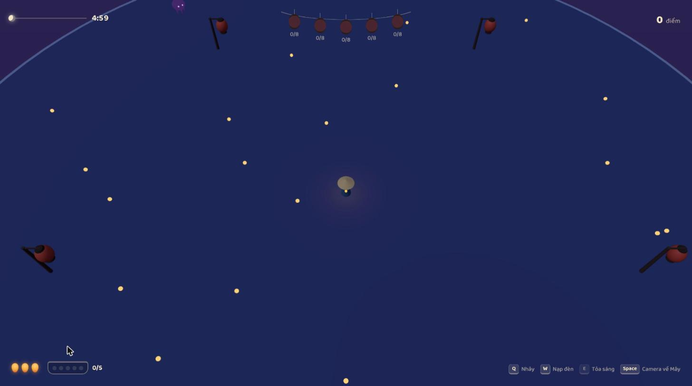

# Đảo Đèn Lồng

> Video demo: _(bổ sung ở Phase 4)_

Game 3D góc nhìn từ trên xuống. Sương đen đã nuốt hết ánh sáng của Đảo Bến. Bạn là **Mây**, người giữ đèn nhỏ tuổi đội nón lá treo một chiếc đèn lồng nhỏ. Mây gom đom đóm rồi mang về thắp lại năm Đèn Lồng Lớn trước khi trời sáng, đồng thời né **Bóng Mực** đang trôi ra từ sương.



Bài làm lab *AI SDLC* (Day 12) của 2A202603689-VuHaiTuan. Tài liệu của lab nằm ở [LAB.md](LAB.md).

## Cài đặt và chạy

Cần Node.js 18 trở lên, chạy trên Linux hoặc macOS.

```bash
git clone https://github.com/ha1tuan/K5-L3A-DAY12-VuHaiTuan-2A202603689-AI-SDLC-Dao-Den-Long.git && cd K5-L3A-DAY12-VuHaiTuan-2A202603689-AI-SDLC-Dao-Den-Long
npm ci && npm run build
npm start
```

`npm start` mở game ở <http://localhost:4173>.

## Điều khiển

| Thao tác | Mặc định |
|---|---|
| Đi tới một điểm | Nhấn chuột trái lên mặt đất |
| Nhảy | Q |
| Nạp đom đóm vào đèn gần nhất | W |
| Tỏa sáng | E |
| Chơi lại (sau khi thắng hoặc thua) | R |
| Nhìn quanh đảo | Đưa chuột ra mép màn hình |
| Đưa camera về Mây / giữ để bám theo | Space |
| Phóng to, thu nhỏ | Lăn chuột |
| Đổi phím | Esc (lưu trong trình duyệt) |

## Luật chơi

- **Đom đóm** tự bay vào lọ khi Mây đi qua, tối đa 5 con.
- **Nạp:** đứng trong 2.5 m quanh một đèn chưa sáng rồi nhấn W. Mỗi đèn cần 8 đom đóm, nạp nhiều lần cũng được. Đủ 8 thì đèn sáng.
- **Bóng Mực** đuổi theo Mây. Bị chạm thì mất 1 lửa và rơi mất một nửa số đom đóm đang mang (làm tròn xuống), sau đó Mây được 1.5 giây không bị chạm.
- **Tỏa sáng** tốn 2 đom đóm, làm choáng 3 giây mọi Bóng Mực trong vòng 6 m và đẩy chúng lùi thêm 4 m. Sau mỗi lần tỏa sáng phải chờ 1.5 giây.
- **Chỗ trú:** Bóng Mực không vào được vòng 6 m quanh một đèn **đã sáng** (vòng sáng vàng trên mặt đất).
- **Thắng** khi cả 5 đèn sáng. **Thua** khi hết 3 lửa, hoặc khi hết 5 phút mà trời đã sáng.

## Cách tính điểm

| Sự kiện | Điểm |
|---|---|
| Nhặt một đom đóm | +10 |
| Thắp sáng một đèn | +100 |
| Mỗi Bóng Mực bị choáng trong một lần tỏa sáng | +25 |
| Khi thắng: mỗi giây còn lại (làm tròn xuống) | +2 |
| Khi thắng: mỗi lửa còn lại | +50 |

Thưởng thời gian và lửa chỉ cộng khi thắng.

**Ví dụ:** thắp đèn cuối cùng ở tick 1 với 3 lửa. Điểm là 100 + 2 × ⌊299.98⌋ + 50 × 3 = **848**. Đây đúng là case `win-all-lit` trong bộ kiểm chứng.

## Chế độ headless (Test Contract v1.0)

Mọi số tuning khai trong [`game.contract.json`](game.contract.json) cũng chính là số game đang dùng, vì sim đọc trực tiếp file này.

```bash
node dist/headless.js --seed 1 --night 1 --ticks 600 --out out.jsonl \
  [--scenario scenarios/pickup.json] [--inputs inputs/move-forward.json] [--snapshot-every 10]
```

- Logic chạy 60 tick/giây cố định, không cần cửa sổ hay GPU. Một đêm 18 000 tick chạy trong khoảng 0.2 s.
- Exit code: `0` khi chạy xong hoặc game kết thúc, `2` khi file inputs/scenario sai định dạng, `1` khi gặp lỗi khác. Thông báo lỗi ghi ra stderr.
- Với cùng seed, scenario và inputs, output giống hệt từng byte.

**Về các tuning:** không có tuning nào là `null`. `fall_enabled` là `false` vì đảo có tường vô hình ở mép (bán kính 40 m), Mây không thể rơi xuống biển mây, nên game không bao giờ phát `player_hit` với `by: "fall"`. Game cũng không có `dash`, nên trường `dash` trong file inputs được chấp nhận nhưng không có tác dụng.

## Kiểm thử

```bash
npm test          # 72 test Vitest: luật chơi qua createSim, contract qua runHeadless
npm run verify    # build rồi chạy binary thật với 23 case + 2 kiểm tra tĩnh, ghi bằng chứng
```

Bằng chứng Phase 1 nằm ở [docs/evidence/phase-1/](docs/evidence/phase-1/README.md).

## Sáng tạo của tôi

Mọi phần dưới đây chỉ nằm ở lớp giao diện (`src/client/`). Chúng không đổi luật chơi hay output headless. Bằng chứng: `npm run verify` vẫn 25/25 sau khi thêm chúng.

- **Dây đèn lồng trên HUD:** năm chiếc đèn treo trên một sợi dây võng, đầy dần theo số đom đóm đã nạp và bừng sáng khi được thắp.
- **Trăng đi về bình minh:** đồng hồ đêm được vẽ như mặt trăng trượt dọc đường chân trời, kèm số phút còn lại.
- **Lọ đom đóm và ngọn lửa:** số đom đóm đang mang và số lửa còn lại hiển thị bằng hình, không chỉ bằng số.
- **Vòng trú ẩn:** đèn đã sáng có vòng sáng 6 m trên mặt đất, cho thấy đúng vùng Bóng Mực không vào được.
- **Đảo sáng dần:** ánh sáng và màu đất ấm lên theo số đèn đã thắp.
- **Đổi phím trong game (Esc):** từ chối phím đã dùng cho hành động khác và nói rõ phím đó đang dùng cho gì, có nút khôi phục mặc định.
- **Bảng điểm cuối đêm:** tách điểm theo từng nguồn (đom đóm, đèn, xua Bóng Mực, thưởng).

## Tài liệu

| File | Nội dung |
|---|---|
| [PRD.md](PRD.md) | Yêu cầu Phase 1 và Test Contract v1.0 |
| [docs/NOTES.md](docs/NOTES.md) | Giả định đã chốt (A1–A14), nhật ký dùng AI, retro |
| [Architect.md](Architect.md) | Kiến trúc: sim, headless, client |
| [docs/PLAN.md](docs/PLAN.md) | Kế hoạch theo mốc |
| [GLOSSARY.md](GLOSSARY.md), [docs/adr/](docs/adr/) | Thuật ngữ và quyết định kiến trúc |
| [CLAUDE.md](CLAUDE.md), [.claude/](.claude/) | Harness AI: hướng dẫn agent, hook chạy test, skill `verify-phase` |
| [CREDITS.md](CREDITS.md) | Nguồn thư viện, phông chữ, công cụ AI |
