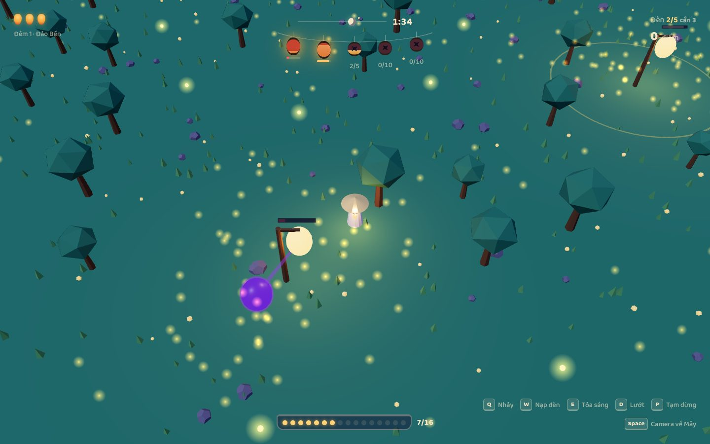
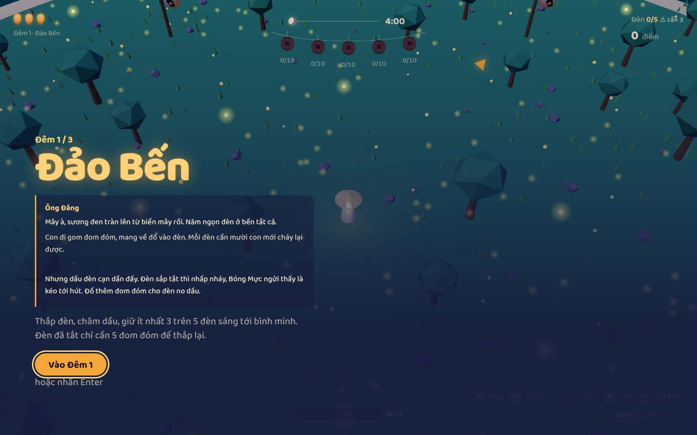
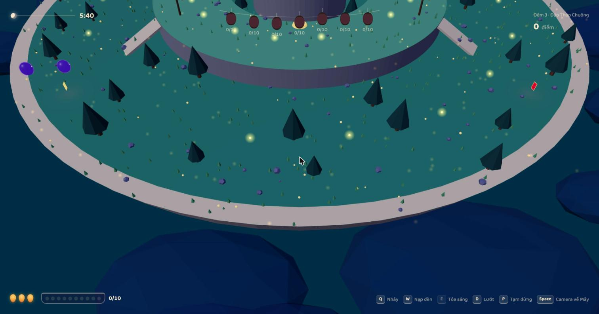
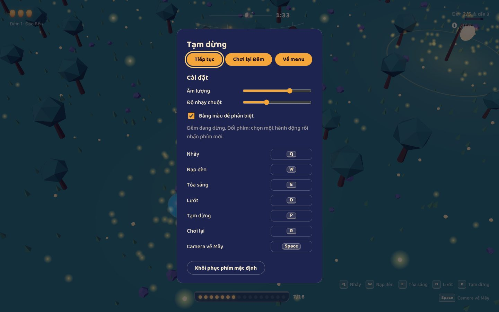
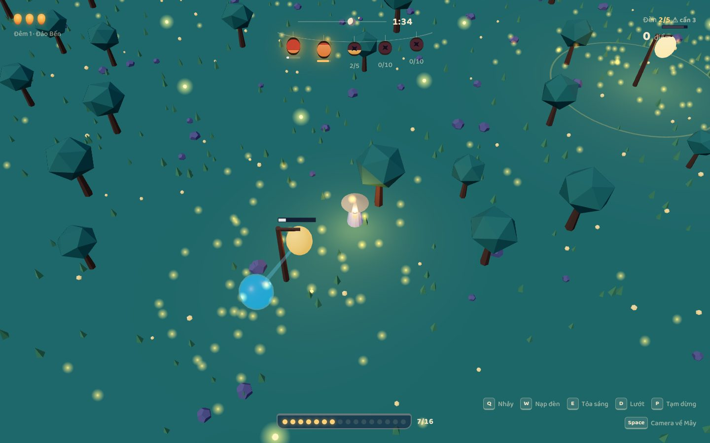

# Đảo Đèn Lồng

> **Video demo:** _chưa có. Kịch bản quay ở [docs/demo/SCRIPT.md](docs/demo/SCRIPT.md)._ · **Bản phát hành:** [Release v1.0.0](https://github.com/ha1tuan/K5-L3A-DAY12-VuHaiTuan-2A202603689-AI-SDLC-Dao-Den-Long/releases/tag/v1.0.0)

Game 3D góc nhìn từ trên xuống. Sương đen đã nuốt ánh sáng của ba hòn đảo. Bạn là **Mây**, người giữ đèn nhỏ tuổi đội nón lá treo một chiếc đèn lồng nhỏ. Qua ba Đêm liền, Mây gom đom đóm về thắp lại Đèn Lồng Lớn của từng đảo, rồi giữ cho đèn đủ dầu tới bình minh. Trên đường phải né **Bóng Mực** trôi ra từ sương, giờ còn biết lần tới hút dầu những chiếc đèn sắp cạn, và **Gió Lạc** chuyên giật đom đóm.



Bài làm lab *AI SDLC* (Day 12) của 2A202603689-VuHaiTuan. Tài liệu của lab nằm ở [LAB.md](LAB.md).

## Yêu cầu hệ thống

- Node.js 18 trở lên (đã thử với Node 22), npm.
- Trình duyệt có WebGL 2: Chrome/Edge 100+, Firefox 100+ hoặc Safari 16+. Card đồ hoạ tích hợp là đủ.
- Đã thử trên Linux (Ubuntu, Wayland). Lệnh `npm` giống nhau trên macOS và Windows.
- Riêng benchmark cần Google Chrome hoặc Chromium (hoặc đặt `CHROME_PATH`).

## Cài đặt và chạy (3 lệnh)

```bash
git clone https://github.com/ha1tuan/K5-L3A-DAY12-VuHaiTuan-2A202603689-AI-SDLC-Dao-Den-Long.git && cd K5-L3A-DAY12-VuHaiTuan-2A202603689-AI-SDLC-Dao-Den-Long
npm ci && npm run build
npm start
```

`npm start` chạy server của game và mở <http://localhost:4173>. Không cần Vite hay mạng khi chơi (phông Baloo 2 tải từ Google Fonts, không có mạng thì dùng phông hệ thống). Không muốn build? Tải `dao-den-long-v1.0.0.zip` ở Release, giải nén rồi chạy `node dist/serve.js --open`. Thêm `?night=2` hoặc `?night=3` vào địa chỉ để vào thẳng Đêm đó, tiện khi thử. `?demo=fuel` mở Đêm 1 giữa chừng với đủ các kiểu đèn: một đèn sắp cạn đang bị Bóng Mực hút, một đèn đầy, một đèn đã tắt.

## Điều khiển

| Thao tác | Mặc định |
|---|---|
| Đi tới một điểm | Nhấn chuột trái lên mặt đất (bậc, cầu, đảo bên kia đều được) |
| Đi lên / xuống / trái / phải (theo hướng camera) | ↑ ↓ ← → |
| Nhảy | Q |
| Nạp đom đóm vào đèn gần nhất (thắp, thắp lại hoặc châm dầu) | W |
| Tỏa sáng | E |
| Lướt | D |
| Tạm dừng (menu Tiếp tục / Chơi lại Đêm / Về menu và Cài đặt) | Esc hoặc P |
| Sang Đêm kế tiếp / chơi lại (ở màn kết quả) | R |
| Nhìn quanh đảo | Đưa chuột ra mép màn hình |
| Đưa camera về Mây / giữ để bám theo | Space |
| Phóng to, thu nhỏ | Lăn chuột |

Trong menu Tạm dừng có thể đổi phím cho mọi hành động (kể cả 4 hướng đi), chỉnh âm lượng và độ nhạy chuột (tốc độ trượt camera và bước zoom). Gán một phím đã dùng thì game báo phím đó đang thuộc hành động nào. Nút **Khôi phục phím mặc định** đưa mọi phím về như bảng trên. Esc luôn dùng để tạm dừng, không gán lại được. Mọi cài đặt được lưu trong trình duyệt.

### Dễ tiếp cận

- **Bảng màu dễ phân biệt:** Bóng Mực chuyển sang xanh `#00B3FF`, cảnh báo thành chữ trắng kèm ⚠, đèn tắt và đèn sắp cạn nhận ra được bằng hình dạng.
- **Phụ đề và chỉ báo hình ảnh** cho mọi âm báo: "Bóng Mực xuất hiện" kèm mũi tên đỏ ở mép màn hình chỉ về Bóng Mực ngoài khung nhìn, "Gió mạnh sắp thổi", đếm 10 giây cuối, "Đèn L*k* sắp cạn dầu".
- **Giảm chuyển động:** tắt mọi nhấp nháy, chớp sáng và vòng loé trên màn hình.
- **Cỡ chữ:** không chữ nào dưới 18 px ở 1280×720; **Chữ lớn** phóng mọi chữ lên ×1.25.

## Bảng xếp hạng

Sau Màn Bình Minh, hoặc khi thua ở bất kỳ Đêm nào, game mời nhập tên (3–12 ký tự: chữ, kể cả tiếng Việt có dấu, số hoặc `_`) để lưu Tổng điểm game của chuỗi. Bảng giữ 10 người cao điểm nhất; bằng điểm thì ai đạt trước đứng trên. Bảng lưu ở `data/leaderboard.json` nên vẫn còn sau khi tắt và mở lại game. Xem từ nút **Bảng xếp hạng** ở menu chính, hoặc xuất ra JSON:

```bash
npm start -- --export-leaderboard out.json     # {"entries": [{name, score, nights_won, achieved_at, seed}, ...]}
```

## Ba Đêm

| Đêm | Đảo | Thời gian | Đèn (cần giữ sáng tới bình minh) | Điểm mới |
|---|---|---|---|---|
| 1 | Đảo Bến | 4:00 | 5 (3) | Đảo tròn bán kính 40 m |
| 2 | Đảo Cau | 4:30 | 6 (4) | Hai đảo nối bằng cầu tre không lan can; hai bục nhảy hất qua khe trời; Gió Lạc; Bùa Gió giữa cầu |
| 3 | Đảo Chuông | 5:00 | 7 (5) | Bậc cao 3 m và 6 m, hai dốc lên bậc, tháp chuông ở giữa; Bóng Mực nhanh hơn (4.5 m/s); gió mạnh |

Trước mỗi Đêm, **Ông Đăng** giới thiệu hòn đảo và mẹo của Đêm đó. Thắng thì điểm Đêm được cộng vào tổng và sang Đêm kế. Thua thì chơi lại chính Đêm đó, không cộng gì. Thắng Đêm 3 thì tới **Màn Bình Minh** với tổng điểm cả chuỗi.

## Luật chơi

- **Đom đóm** tự bay vào lọ khi Mây đi qua (trong 1 m). Lọ chứa 10 con lúc đầu Đêm, mỗi lần thắp hoặc thắp lại một đèn thành công thì rộng thêm 2, tối đa 20.
- **Nạp và thắp:** đứng trong 2 m quanh một đèn tắt rồi nhấn W. Đèn chưa từng sáng cần 10 đom đóm, đèn đã từng sáng rồi tắt chỉ cần 5 để **thắp lại**. Nạp nhiều lần cũng được. Đèn vừa thắp có đầy dầu (100).
- **Dầu đèn:** đèn sáng hao 1 dầu mỗi giây. Hết dầu thì đèn tắt và mất số đom đóm đã nạp. Nhấn W cạnh một đèn đang sáng để **châm dầu**: mỗi đom đóm thêm 10 dầu, chỉ dùng vừa đủ để đầy. Đèn đã đầy thì bị bỏ qua, W áp vào đèn gần nhất còn nhận được. Khi dầu dưới 30, đèn và thanh dầu nhấp nháy chậm.
- **Bóng Mực** xuất hiện từ giây thứ 5, lúc đầu lang thang, tới gần 12 m thì đuổi. Bị chạm thì mất 1 Ngọn Lửa và rơi một nửa số đom đóm đang mang (làm tròn xuống) ra đất; đom đóm rơi biến mất sau 8 giây. Sau đó Mây có 1.5 giây không bị chạm.
- **Bóng Mực hút dầu:** Bóng Mực đang lang thang sẽ tìm tới đèn sắp cạn (dầu dưới 30) gần nhất. Tới trong 2 m thì đứng yên hút thêm 5 dầu mỗi giây; nhiều con thì cộng dồn. Nó bỏ đi khi đèn tắt hoặc được châm lên từ 30 trở lên, và quay sang đuổi khi Mây tới gần trong 6 m.
- **Tỏa sáng** tốn 3 đom đóm, làm choáng 2 giây mọi Bóng Mực trong vòng 5 m và đẩy chúng lùi 4 m. Sau mỗi lần tỏa sáng phải chờ 3 giây.
- **Lướt** đi 14 m/s trong 0.2 giây theo hướng đang chạy, giữ nguyên độ cao nếu đang ở trên không. Chờ 1.5 giây mới lướt tiếp. Lướt không giúp né đòn.
- **Chỗ trú:** Bóng Mực không vào được vòng 6 m quanh một đèn đang sáng còn từ 30 dầu trở lên. Con nào đang ở trong lúc đèn vừa thắp, thắp lại hay được châm vượt 30 bị đẩy ra ngoài và không gây hại trong lúc bị đẩy. Đèn sắp cạn **mất** chỗ trú.
- **Gió Lạc** (Đêm 2 và 3): 20 giây xuất hiện một con, tối đa 2. Khi Mây mang từ 5 đom đóm trở lên và ở gần, nó sà tới giật tối đa 3 con rồi bỏ chạy. Tỏa sáng trúng nó thì nó nhả lại đom đóm. Nó giật được cả khi Mây đang trong chỗ trú.
- **Bùa Gió:** nhặt được thì trong 10 giây Mây chạy 7.2 m/s và lướt không phải chờ. Bùa mọc lại sau 45 giây.
- **Rơi khỏi đảo:** mép đảo không có rào. Rơi xuống biển mây thì mất 1 Ngọn Lửa và toàn bộ đom đóm đang mang, 1 giây sau Mây quay lại điểm xuất phát.
- **Gió mạnh** (Đêm 3): cứ 30 giây thổi 5 giây, đẩy Mây thêm 2 m/s theo một hướng. Lá bay và banner báo trước 2 giây.
- **Thắng** khi Mây còn sống lúc hết giờ (bình minh) và số đèn đang sáng ở giây cuối đạt ít nhất 60% số đèn, làm tròn lên: 3/5, 4/6, 5/7. Thắp đủ đèn **không** kết thúc Đêm sớm. **Thua** khi hết 3 Ngọn Lửa (kể cả ngay giây cuối) hoặc khi bình minh đến mà không đủ đèn sáng.

## Cách tính điểm

| Sự kiện | Điểm |
|---|---|
| Mỗi đom đóm nạp vào đèn (thắp, thắp lại hoặc châm dầu) | +5 |
| Thắp một đèn lần đầu | +100 |
| Thắp lại một đèn đã tắt | +40 |
| Mỗi Bóng Mực trúng một lần tỏa sáng | +5, hoặc +15 nếu nó đang hút dầu |
| Khi thắng, ở bình minh: mỗi đèn đang sáng | +50 + phần nguyên của dầu còn lại |
| Khi thắng, ở bình minh: mỗi Ngọn Lửa còn lại | +50 |

Nhặt đom đóm không có điểm; điểm tính lúc nạp. Không còn thưởng thời gian.

**Ví dụ:** Đêm 2, bình minh đến khi 4 trên 6 đèn còn sáng, mỗi đèn còn 99.95 dầu, Mây còn 3 Ngọn Lửa. Thưởng bình minh là 4 × (50 + 99) + 3 × 50 = **746**. Đây đúng là case `p3_ac13_dawn_win` trong bộ kiểm chứng.

## Chế độ headless (Test Contract v1.3)

Mọi số tuning khai trong [`game.contract.json`](game.contract.json) cũng chính là số game đang dùng, vì sim đọc trực tiếp file này. Đây đúng bộ số chuẩn của PRD v2 §6.1, cộng các khoá dầu đèn của PRD v3 §6.

```bash
node dist/headless.js --seed 1 --night 1|2|3 --ticks 600 --out out.jsonl \
  [--scenario scenarios/p2-charm.json] [--inputs inputs/p2-charm-run.json] [--snapshot-every 10]
```

- Logic chạy 60 tick/giây cố định, không cần cửa sổ hay GPU. Trọn một Đêm 3 (18 000 tick) chạy trong khoảng 1 s.
- Inputs có thêm `dash` và `pause`. Khi tạm dừng, `tick` vẫn tăng nhưng `sim_tick`, đồng hồ và mọi bộ đếm đứng yên; snapshot có `state: "paused"`.
- Snapshot v1.1 có thêm `night`, `wind`, thông tin của Mây (vận tốc, chạm đất, hồi chiêu, bùa), danh sách đom đóm, Gió Lạc và Bùa Gió.
- v1.2: mỗi đèn có thêm `fuel` (một chữ số thập phân), `ever_lit`, `relit_count`; Mây có `capacity`; Bóng Mực có trạng thái `drain`. Sự kiện mới `refuel`, `lantern_out`, `fuel_drain`; `lantern_lit` có `relight`; `game_over.reason` là `dawn_survived`, `dawn` hoặc `no_flames`. Scenario đặt được `lit`/`fuel`/`ever_lit` cho đèn, `player.successful_lights` và `shades[].target_lantern_id`.
- Dầu được lưu bằng số nguyên (1/60 đơn vị) để tính tất định, chỉ làm tròn khi xuất. Ngưỡng "đầy" và "sắp cạn" so trên giá trị đã làm tròn đó (giả định A48, A49 trong NOTES).
- Exit code: `0` khi chạy xong hoặc game kết thúc, `2` khi file inputs/scenario sai định dạng, `1` khi gặp lỗi khác. Thông báo lỗi ghi ra stderr.
- Với cùng seed, scenario và inputs, output giống hệt từng byte.
- Không có tuning nào là `null`. `fall_enabled` là `true`: Mây rơi được khỏi mép đảo và phát `player_hit` với `by: "fall"`.

## Benchmark và soak test (PRD v4)

```bash
npm run bench -- --seed 42 --duration 30 --out bench.json   # = node scripts/bench.mjs …
npm run soak -- --seed 7 --nights 10 --out soak.json         # = node --expose-gc --single-threaded --max-semi-space-size=1 dist/soak.js …
```

- **Bench** mở cửa sổ Chrome 1280×720 với vsync tắt (`--disable-gpu-vsync --disable-frame-rate-limit`; trên Linux chạy qua XWayland vì Wayland bỏ qua hai cờ này). Cảnh chuẩn: Đêm 1 đủ hiệu ứng, 200 Bóng Mực lang thang, 100 đom đóm, L1–L3 sáng đầy dầu, camera bay vòng bán kính 30 m ở độ cao 15 m, 15 s một vòng ngược chiều kim đồng hồ. Sau 3 s khởi động thì đo đúng `--duration` giây rồi ghi `bench.json` và thoát mã 0. Thêm `--headless` để chạy không cửa sổ (GPU phần mềm, số thấp hơn nhiều). `peak_mem_mb` là tổng RSS của mọi tiến trình Chrome.
- **Soak** chạy 10 Đêm liền (1 → 2 → 3 xoay vòng, Đêm thứ i dùng seed 7 + i) với input ngẫu nhiên theo seed, trong một tiến trình Node, không cần trình duyệt.

Kết quả trên máy tự đo (Intel Core Ultra 5 225H, đồ hoạ tích hợp Intel Arc, 30 GB RAM, Linux 7.0, Chrome 157; máy chấm sẽ khác):

| | Kết quả | Ngưỡng |
|---|---|---|
| `avg_fps` | 318.1 | ≥ 60 |
| `p1_low_fps` | 107.7 | ≥ 30 |
| `load_ms` | 2133 | ≤ 10000 |
| Soak `crashes` | 0 | 0 |
| Soak bộ nhớ | 64.0 → 70.3 MB (×1.10) | ≤ ×1.2 |

## Kiểm thử

```bash
npm test          # 190 test Vitest: luật chơi qua createSim, contract qua runHeadless, soak, bảng xếp hạng, server, hàm thuần của client
npm run verify    # build rồi chạy binary thật với 68 case + 2 kiểm tra tĩnh, ghi bằng chứng
node scripts/ui-check.mjs docs/evidence/phase-4/ui   # lái game đã build trong Chrome, chụp ảnh và kiểm chữ ≥ 18 px, phụ đề, đổi phím, bảng xếp hạng
```

Bằng chứng nằm ở [docs/evidence/phase-1/](docs/evidence/phase-1/README.md), [phase-2](docs/evidence/phase-2/verify-report.md), [phase-3](docs/evidence/phase-3/verify-report.md) và [phase-4](docs/evidence/phase-4/) (`bench.json`, `soak.json`, `verify-report.md`, ảnh và log giao diện ở `ui/`). Mọi số kỳ vọng trong `scenarios/cases.mjs` được tính tay từ PRD, mỗi case ghi rõ cách tính. Mỗi tiêu chí AC-01 đến AC-17 của PRD v3 có ít nhất một case chạy trên binary thật. AC-18 có test hàm thuần và ảnh chụp.

## Sáng tạo của tôi

Mọi phần dưới đây chỉ nằm ở lớp giao diện (`src/client/`). Chúng không đổi luật chơi hay output headless. Bằng chứng: `npm run verify` vẫn 70/70 sau khi thêm chúng.

- **Ba hòn đảo 3D dựng từ dữ liệu bản đồ của sim:** bãi cát viền đảo, khối đá treo dưới đảo, cầu tre, bậc đá, dốc, tháp chuông mái đỏ với quả chuông vàng, biển mây và bầu trời sao.
- **Cây cối và mặt đất sống động:** mỗi đảo một loài cây (cây tán tròn, cau, thông) đung đưa trong gió, cùng bụi cỏ, hoa nhỏ phát sáng và sỏi. Cây tự tránh đèn, điểm đom đóm, bục nhảy và bùa nên không chắn đường.
- **Đom đóm bay:** đom đóm nhặt được bay vòng và nhấp nhô; đom đóm rơi nhấp nháy trước khi biến mất. Thêm 300 đom đóm trang trí trôi khắp đảo và bay về tụ quanh đèn đã sáng.
- **Lời mở đầu của Ông Đăng** trước mỗi Đêm, hiện từng câu trên nền hòn đảo sắp chơi.
- **Âm thanh tổng hợp bằng WebAudio**, không dùng file: nhạc ru ngũ cung, âm cho từng sự kiện, đếm ngược 10 giây cuối, tiếng gió báo trước.
- **Dây đèn lồng trên HUD:** các chiếc đèn treo trên một sợi dây võng, đầy dần theo số đom đóm đã nạp và bừng sáng khi được thắp.
- **Trăng đi về bình minh:** đồng hồ đêm vẽ như mặt trăng trượt dọc đường chân trời.
- **Mũi tên chỉ đèn** ở mép màn hình khi đèn chưa sáng gần nhất nằm ngoài khung nhìn.
- **Vệt lướt, dải lụa Gió Lạc gợn sóng, vòng trú ẩn 6 m** quanh đèn đã sáng, và đảo sáng dần theo số đèn đã thắp.
- **Bảng điểm cuối Đêm:** tách điểm theo từng nguồn (thắp, thắp lại, châm dầu, xua Bóng Mực đang hút, thưởng bình minh), cộng dồn tổng của cả chuỗi.
- **Đèn dầu nhìn thấy được (Phase 3):** thanh dầu lơ lửng trên mỗi đèn sáng, đèn sắp cạn nhấp nháy 1 Hz, đèn tắt xẹp xuống và giấy rách, tia hút nối Bóng Mực với chiếc đèn nó đang hút, đảo tối dần khi đèn tắt. Dây đèn trên HUD có thanh dầu nhỏ và dòng "cần k" đèn để thắng.

| Ông Đăng giới thiệu Đêm | Đêm 3 – Đảo Chuông | Menu Tạm dừng |
|---|---|---|
|  |  |  |

| Bảng màu dễ phân biệt: Bóng Mực xanh, cảnh báo ⚠ |
|---|
|  |

## Tài liệu

| File | Nội dung |
|---|---|
| [PRD.md](PRD.md), [PRD_v2.md](PRD_v2.md), [PRD_v3.md](PRD_v3.md), [PRD_v4.md](PRD_v4.md) | Yêu cầu Phase 1 (Test Contract v1.0), Phase 2 (v1.1), Phase 3 (v1.2) và Phase 4 (v1.3, hiện hành) |
| [CHANGELOG.md](CHANGELOG.md) | Breaking changes từng phase |
| [docs/NOTES.md](docs/NOTES.md) | Giả định đã chốt (A1–A60), nhật ký dùng AI, đánh giá từng phase |
| [docs/RETRO.md](docs/RETRO.md) | Retro cả 4 phase |
| [Architect.md](Architect.md) | Kiến trúc: sim, headless, client |
| [docs/PLAN.md](docs/PLAN.md) | Kế hoạch theo mốc |
| [GLOSSARY.md](GLOSSARY.md), [docs/adr/](docs/adr/) | Thuật ngữ và quyết định kiến trúc (ADR-0003: đèn có dầu, thắng ở bình minh, thứ tự tick v1.2) |
| [CLAUDE.md](CLAUDE.md), [.claude/](.claude/) | Harness AI: hướng dẫn agent, hook chạy test, skill `verify-phase`, `game-engine` |
| [CREDITS.md](CREDITS.md), [LICENSE](LICENSE) | Nguồn thư viện, phông chữ, công cụ AI; giấy phép MIT |
